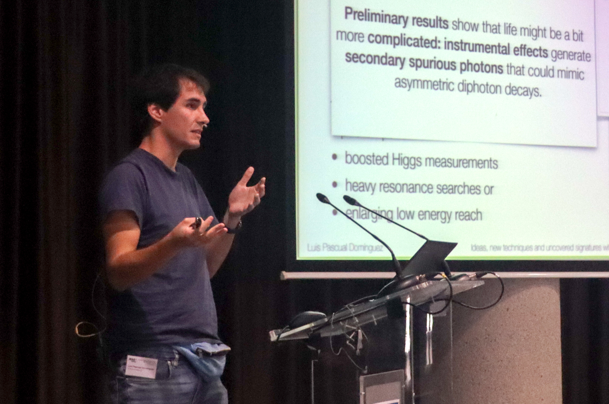

---
---

::: {.hero-section}
::: {.hero-image}
{.profile-photo}
:::
::: {.hero-text}
# Luis Pascual Domínguez

### Experimental Particle Physicist

Postdoctoral Research Fellow · Universidad Autónoma de Madd 
ATLAS Collaboration · CERN

I am an experimental particle physicist and I joined the ATLAS collaboration at the Large Hadron Collider in 2017 as a PhD student and I have been a qualified ATLAS author since 2018. My current research areas are focused on photon physics, Higgs boson measurements and searches for New Physics. 

My research spans physics analyses and detector-level activities, with experience in photon and lepton reconstruction, identification and isolation, instrumental to improve our knowledge of Nature through the analysis of proton-proton collision at the LHC. 

[Research](research.qmd){.btn .btn-primary}
[Selected publications](publications.qmd){.btn .btn-outline-primary}
:::
:::

## Main research interests

- **Higgs boson physics:** measurements and searches involving rare and unconventional Higgs boson signatures.
- **Beyond the Standard Model:** searches for additional scalar particles, low-mass resonances and collimated leptonic signatures.
- **Photon reconstruction, identification and isolation:** photon reconstruction, identification and isolation performances in hadron colliders for particle physics analyses.

## Current projects

My current work at UAM focuses on the development and implementation of [SoftDrop-based photon isolation](https://arxiv.org/abs/1805.11622), with applications for future pileup environments. 

Other activities include: low mass diphoton resonance searches, Higgs boson measurements

## Academic profile

- [Curriculum vitae](cv.qmd)
- [Selected publications](publications.qmd)
- [ATLAS Collaboration](https://atlas.cern/)
- [GitHub](https://github.com/luipascu)
- [INSPIRE-HEP](https://inspirehep.net/authors/1624627)
- [ORCID](https://orcid.org/0000-0003-4701-9481)

[Contact me](mailto:luis.pascual@cern.ch)

